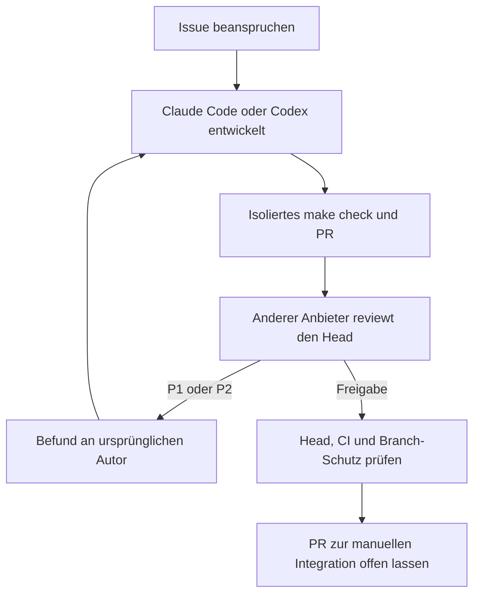

# Entwicklungsorchestrator für Trading_Ai

**Status: MVP implementiert und offline getestet.** Ausführung und Automerge sind deaktiviert.
Für diesen Stand gelten die Freigaben in AGENTS.md §2a, §2b und der Spec §21. Die Betriebsfreigabe,
das unabhängige Review der Isolation und der separat durch Bas freigegebene beaufsichtigte
erste Lauf sind Voraussetzungen für die Aktivierung der Ausführung. Änderungen am Orchestrator
sind Klasse K.

## Ablauf

Der Controller wählt ein unbeanspruchtes Issue mit `backlog`, `auto-ready`, `effort:medium` und
`work:coding`. Die Aufgabennummer braucht einen Klasse-U-Eintrag in der lokalen YAML-Datei mit genauen
Dateipfaden und Abhängigkeiten. Die Positivliste im Controller enthält für den ersten Pilot
ausschließlich `docs/REPORTS.md`. Jeder weitere Pfad erfordert eine unabhängige Prüfung seiner
Funktion und Aufrufer. Priorität ergibt sich aus `priority`, der Reihenfolge unter
„Nächste Ziele“ in STATUS.md und der Issue-Nummer. Der Controller zieht GitHub-Abhängigkeiten,
`depends_on` in YAML und Issue-Zeilen wie `Abhängigkeiten: #12, #17` heran. Abhängigkeiten im Projekt
müssen geschlossen und als `done` markiert sein. Offene PRs derselben Task-ID und bestehende Claims
schließen eine Übernahme aus.



Der Steuerprozess veröffentlicht Commit, PR und Kommentar-Review. Jeder Review-Head wird davor erneut
mit `make check` geprüft. Korrekturen gehen mit den Befunden an denselben Autor. Drei Korrekturen sind
das absolute Maximum. Ein identisch gemeldeter blockierender Befund stoppt früher. Ein positives
Review gilt für genau den gespeicherten Head-SHA und `main`. Der nächste aktive Task startet nach dem
Abschluss der automatischen Schritte. Bereits existierende fremde PRs bleiben im normalen
manuellen Projekt-Review-Prozess.

Die nachfolgende Integration erfolgt gemäß AGENTS.md §2a. Der im MVP vorhandene bedingte
Merge-Pfad ist per Konfiguration deaktiviert. `merge_enabled` bleibt `false`; den Schalter zu
aktivieren ist gemäß AGENTS.md §2a unzulässig. Eine technische Sperre braucht einen separaten
Klasse-K-Change. Klasse U ist vorab von Bas zu
klassifizieren. Eine Dateiliste allein kann kritische Semantik nicht erkennen.

## Ausführungsgrenzen

- Der Controller läuft als eigener Nicht-root-Benutzer in einem dedizierten sauberen Clone ohne
  `.env`, Broker-Zustände oder lokale Modellregistry. Nur dieser Prozess hält GitHub-Schreibrechte.
  Ein GitHub-Token mit administrativen Schreibrechten ist nicht für den Betrieb vorgesehen. Das
  Lesen der Branch-Protection-Konfiguration kann eigene GitHub-Leseberechtigungen erfordern.
- Agenten und Prüfschritte erhalten Git-Snapshots ohne `.git` als schreibgeschützten Mount.
  Entwicklung und Tests schreiben ausschließlich in begrenzte Container-Arbeitsverzeichnisse.
  Der Controller übernimmt nur ausdrücklich erlaubte Textdateien und prüft die exakte
  Commit-Kandidatenversion erneut in einem frischen Offline-Container. Dateiverknüpfungen werden
  abgelehnt. Agenten erhalten weder Host-Home noch Docker-Socket, GitHub- oder Broker-Anmeldedaten.
- Codex und Claude Code verwenden getrennte Subscription-Logins in separaten Docker-Volumes.
  Die Volumes sind in Autoren- und Reviewläufen schreibgeschützt. Jeder Lauf startet mit einem
  frischen Home im tmpfs und übernimmt ausschließlich `.codex/auth.json` bzw.
  `.claude/.credentials.json`. Einstellungen, Hooks und Sitzungszustand aus dem Volume werden
  nicht übernommen. Claude lädt keine User-, Project- oder Local-Settings. Ein Token-Refresh im
  Container bleibt auf diesen Lauf beschränkt. Bei abgelaufener Anmeldung die CLI im separaten
  Anmeldecontainer erneut anmelden. Jedes Agentennetz ist eine interne Docker-Bridge mit einem separat
  bereitgestellten, auf den jeweiligen Anbieter beschränkten Forward-Proxy. Den Proxy, Docker-Daemon
  und das unveränderlich per Digest referenzierte Image vor der Freigabe unabhängig prüfen. GitHub,
  Broker, andere Konten und Hostdienste dürfen über den Agentenproxy nicht erreichbar sein.
- CPU, RAM, PID-Zahl, temporärer Speicher, einzelne Dateigrößen, Agentenausgaben, Prozesslaufzeit,
  Aufgabenzahl und maximale Aufgabendauer sind begrenzt. Docker-Ausgabelogs sind abgeschaltet.
  SQLite enthält nur Statusereignisse, Claims, Cooldowns und konkrete Review-Befunde für Korrekturen.
  `status` zeigt Ereignisse mit Zeitstempeln und unterdrückt die Befundtexte.
- Ein bekanntes Nutzungslimit setzt den Anbieter und die betroffene Aufgabe bis zum konfigurierten
  Wiederanlaufzeitpunkt zurück. Danach wird derselbe Schritt mit demselben Modell erneut versucht.
  Zusätzliche Konto-Usage/Credits müssen im Anbieter-Konto deaktiviert sein. Es gibt weder
  Abrechnungs-Fallback noch automatischen Modellwechsel. Unklare Fehler blockieren mit erhaltenem
  Claim. Ein unterbrochener Schreibschritt wird nach Neustart blockiert, weil auf GitHub bereits
  Änderungen angekommen sein könnten. Saubere Checkpoints laufen weiter.
- Lokale und weitere Modelle laufen über **agentgateway** (T-025, siehe unten). Sie erhalten nur Text
  über die OpenAI-kompatible Schnittstelle, keine Werkzeuge, keine Agenten- oder GitHub-Anmeldung und
  kein Freigabe- oder Merge-Recht. Ressourcenlimits sind auf dem Ollama-Server einzustellen.

## Rollen, Modellfamilien und Aufwand (T-025)

Der Orchestrator arbeitet mit **Rollen** statt festen Anbietern. Eine Rolle legt fest:

| Feld | Bedeutung |
|---|---|
| `provider` | `codex` oder `claude` (Abo-CLI im isolierten Container) oder `gateway` (Modell hinter agentgateway) |
| `model` | nur bei `gateway`: der Alias aus [agentgateway.yaml](../config/agentgateway.yaml), nie ein konkretes Modell |
| `family` | Modellfamilie für die Unabhängigkeitsregel (z. B. `openai`, `anthropic`, `qwen`, `gemma`) |
| `effort` | `low`, `medium` oder `high`: bei Codex/Claude als CLI-Flag, bei Gateway-Rollen als Ausgabebudget (2.048 / 4.096 / 8.192 Tokens) |
| `reasoning` | nur bei `gateway`, optional: `true` sendet den Aufwand zusätzlich als `reasoning_effort` (nur für Modelle mit Denkmodus, z. B. qwen3; qwen3-coder und gemma3 lehnen den Parameter ab) |

- `author` ist die Standard-Autorenrolle. Ein Issue-Label `agent:<rolle>` wählt eine andere Rolle.
- `reviewers` ist eine Vorzugsliste. Die erste Rolle mit anderer Modellfamilie **und anderer
  Kombination aus Anbieter und Modell bzw. Gateway-Alias** prüft. Gibt es keine, startet der
  Orchestrator nicht bzw. wählt die Aufgabe nicht aus (AGENTS.md §2a).
- Der Controller bindet laufende Aufgaben an den Dateiscope, die aufgelösten Rollen und ihre
  Verbindungseinstellungen. Geänderte oder fehlende Bindungen (auch Alteinträge) blockieren den
  weiteren Ablauf. Bindungen an Gateway-Aliase prüfen die Orchestrator-Konfiguration.
  Der Betreiber hält die Modellzuordnung hinter den Aliasen während eines laufenden Jobs stabil.
- Aufgaben können optional `draft_role` (lokale Erstfassung für den Autor) und `hint_role` (lokale
  Vorab-Hinweise für den Prüfer) setzen. Beide müssen Gateway-Rollen sein.
- Eine Gateway-Rolle als **Autor** erhält die vollständigen UTF-8-Originale der erlaubten Dateien als
  Arbeitsdaten (maximal 16.000 Bytes serialisierter Dateikontext). Kann der Controller die Originale
  nicht vollständig übertragen, blockiert er den Auftrag vor dem Modellaufruf. Die Rolle liefert
  vollständige Dateiinhalte als JSON. Der Controller übernimmt sie nur für erlaubte Pfade.
- Eine Gateway-Rolle als **Prüfer** liefert dieselbe `REVIEW_RESULT`-Zeile wie Codex/Claude. Gemessen am
  2026-11-19: gemma3:12b wies mit dem Review-Prompt des Orchestrators einen synthetischen Diff „50 % Risiko pro
  Trade“ in 3 von 3 Läufen zurück, gab ihn mit einem minimalen Prompt aber frei. Lokale Prüfer sind deshalb nur
  für die vorab freigegebenen Klasse-U-Pfade gedacht. Für Klasse K bleibt das unabhängige Review durch
  Claude Code, Codex oder Bas Pflicht (AGENTS.md §2a).
- PRs, Commits und Reviews tragen die Rolle als `Agent: <rolle> / <modell> / <aufwand>`. Die
  Herkunftsprüfung vor Review und Merge liest genau diese Zeile.
- Kontingentpausen gelten weiterhin je Anbieterkonto (`codex`, `claude`), nicht je Rolle.

### agentgateway

- Version **1.7.0** (Apache-2.0), Binärdatei aus den GitHub-Releases von `agentgateway/agentgateway`, per
  SHA-256 geprüft, z. B. unter `~/.local/bin/agentgateway`.
- [agentgateway.yaml](../config/agentgateway.yaml) bildet die Rollen-Aliase auf Ollama-Modelle ab
  (`local-coder` → qwen3-coder:30b, `local-reviewer` → gemma3:12b, `local-doku` → qwen3:8b). Externe
  Anbieter sind nur als auskommentierte Vorlage enthalten; Schlüssel kämen ausschließlich aus
  Umgebungsvariablen. agentgateway ersetzt Umgebungsvariablen **auch in Kommentaren** und bricht bei
  fehlenden ab.
- Lokaler Betrieb: `scripts/agent_gateway.sh` (bzw. `--check` zur Prüfung). Alle Listener (4000 für LLM,
  15000 Admin, 15020/15021) sind auf `127.0.0.1` gebunden; ohne `bindAddress` würde agentgateway auf allen
  Schnittstellen lauschen. Das Skript startet eine private Kopie der Konfiguration (0600 in 0700), weil
  agentgateway einen erzeugten Sitzungsschlüssel in seine Konfigurationsdatei zurückschreibt.
- Im Orchestrator läuft agentgateway als Container `agentgateway` in einem eigenen internen Docker-Netz
  (`gateway.network`) und erreicht Ollama über ein zweites internes Netz. Für den Container ist eine
  Variante mit `bindAddress` der Netzwerkschnittstelle nötig; sie wird beim beaufsichtigten ersten
  Lauf erstellt und geprüft.

## Einrichtung und Betrieb

1. Python 3.12+, Git, GitHub CLI und einen dedizierten Docker-Daemon bereitstellen. Im Controller-
   Python-Environment PyYAML aus `requirements-dev.txt` installieren und den GitHub-Konto-Zugriff
   ausschließlich dort einrichten. Den Controller mit einem sauberen Clone starten.
2. Architektur und Netz-/Rechte-Trennung unabhängig prüfen. Das Worker-Image aus
   [dev-orchestrator.Dockerfile](../config/dev-orchestrator.Dockerfile) mit geprüften CLI-Versionen
   bauen, in eine freigegebene Registry veröffentlichen und lokal laden. Beide CLIs in ihren
   jeweiligen Volumes mit der späteren Container-UID interaktiv anmelden. Den Dateispeicher für
   Codex verwenden. Beim beaufsichtigten Lauf prüfen, ob beide CLIs diese Anmeldung aus dem frischen
   Home erkennen, und ob die Codex-Sandbox unter `no-new-privileges` tatsächlich ihre Grenzen
   durchsetzt: `workspace-write` darf nur im vorgesehenen Arbeitsbereich schreiben und
   `read-only` muss Schreibversuche abweisen. Einen Fehler oder eine schwächere Isolation als
   Blockade behandeln. Auch die Testimage-Abhängigkeiten prüfen.
3. [YAML-Beispiel](../config/dev-orchestrator.yaml) außerhalb des Clones kopieren, private
   Zustandsablage, Image-Digest, Modelle, Netze und mindestens einen freigegebenen Scope setzen.
   `TRADING_DEV_STATE` und `TRADING_DEV_IMAGE` überschreiben die jeweiligen YAML-Werte.
4. `plan` prüft die Auswahl lesend. Nach Freigabe zunächst lediglich `execution_enabled: true`
   setzen, einen harmlosen Pilot-Task markieren und den Dienst mit `start --execute` beaufsichtigen.
   `merge_enabled` bleibt `false`.

```bash
python3.12 scripts/dev_orchestrator.py plan --config /absolute/pilot.yaml
python3.12 scripts/dev_orchestrator.py status --config /absolute/pilot.yaml
python3.12 scripts/dev_orchestrator.py start --config /absolute/pilot.yaml --execute
```

Unter macOS führt ein LaunchAgent den Vordergrundbefehl als `ProgramArguments` aus. Setze
`WorkingDirectory` auf den Clone und `KeepAlive.SuccessfulExit` auf `false`. Unter Linux verwende
denselben Befehl als `ExecStart` eines systemd-User-Diensts mit `WorkingDirectory`,
`Restart=on-failure` und `RestartSec=30`. Benutze absolute Pfade zum Python und zur YAML-Datei.
Der Prozess startet genau einen Worker. Für Pause, Fortsetzen, Stop und Status verwende dieselbe
Konfiguration mit `pause`, `resume`, `stop` oder `status` statt `start`.

Pause und Stop greifen an der nächsten sicheren Grenze. Ein per `stop` beendeter Dienst wird erst
nach `resume` und einem erneuten Dienststart aktiv. Bei `blocked` den GitHub-Claim, den Branch,
offene PRs und gegebenenfalls erhaltene Docker-Container abgleichen. Nachdem der Vorgang manuell
abgeschlossen oder verworfen, das Issue geschlossen und der zugehörige PR geschlossen ist, kann
`resolve ISSUE_NUMMER` den lokalen Eintrag abschließen und weitere Aufgaben wieder freigeben.
Bei gesetzter Cluster-/Parallelregel darf es nur einen Dienst für einen Zustandsordner geben.
Automatische Merges lösen keinen Trading- oder Livebetrieb aus.

## Nachweise

Mock-Integration und echte lokale Git-Worktrees prüfen Auswahl, Abhängigkeiten, Korrekturzyklen,
persistente Anbieterpausen, Neustart, CI-Wartezustand, Scope und Freigabe für den aktuellen SHA.
Der echte Docker-/GitHub-/Abo-End-to-End-Lauf ist an die Betriebsvoraussetzungen oben gebunden.

CLI- und API-Referenzen: [Codex](https://developers.openai.com/codex/noninteractive/),
[Claude Code](https://code.claude.com/docs/en/cli-reference),
[Docker](https://docs.docker.com/reference/cli/docker/container/run),
[GitHub-Branch-Schutz](https://docs.github.com/en/rest/branches/branch-protection),
[GitHub-Issue-Abhängigkeiten](https://docs.github.com/en/rest/issues/issue-dependencies).
